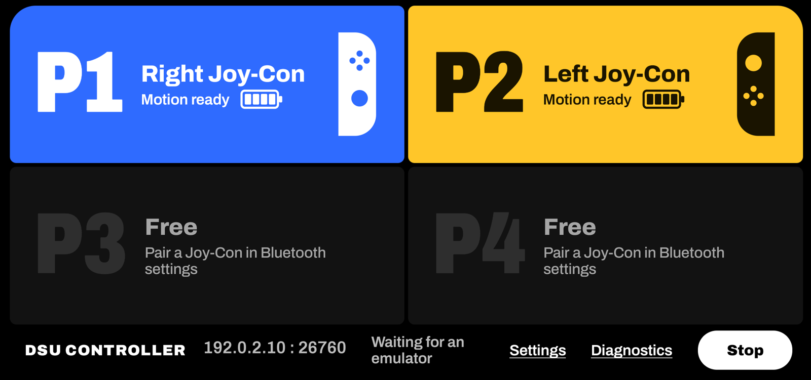
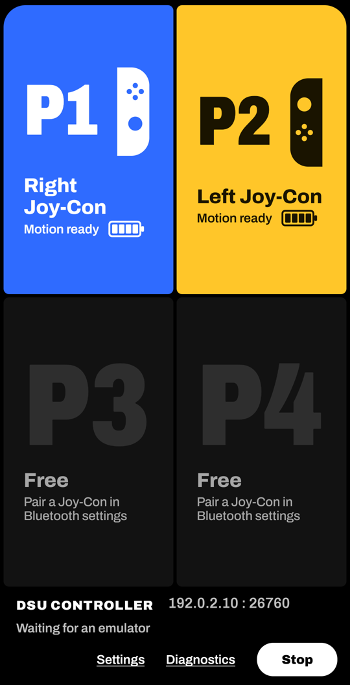

# DSU Controller

**Use your Joy-Con as motion controllers for emulators, through your Android phone.**

DSU Controller is a small Android app that takes the Nintendo Switch Joy-Con paired to your
phone by Bluetooth and serves them to an emulator on your local network over the DSU
(cemuhook) protocol: gyroscope, accelerometer, buttons and stick, one Joy-Con per player.

It is made for one situation: the emulator runs on a machine in another room, the game is
streamed to your TV, and the Joy-Con in your hand are out of that machine's Bluetooth range.
The phone sits next to you and bridges them.

> **Status: ready for a first release.** The bridge, the dashboard and the settings work on a
> real phone with original Joy-Con, and the motion axes are measured. See the
> [roadmap](#roadmap).

<p align="center">
  
</p>

## Highlights

- **Joy-Con to DSU bridge.** Up to four Joy-Con, each one its own controller slot, with motion,
  buttons and stick.
- **Works with DSU clients.** Built and checked against the UDP input driver of Eden and other
  yuzu-lineage emulators; other emulators with cemuhook motion support (such as Cemu and
  Dolphin) speak the same protocol.
- **Your phone needs no gyroscope.** The motion comes from the Joy-Con, so budget phones work.
- **A dashboard you can read from the sofa.** The screen is split in four colour blocks, P1 to
  P4, and the Joy-Con's own player lights show the same number.
- **Private by design.** No accounts, analytics, ads or cloud. The only network traffic is one
  local UDP socket, and only machines you approve on screen get any data.
- **No libraries.** The APK contains the Android framework APIs and the Kotlin standard library,
  nothing else. You can read the whole source in one sitting.

## Requirements

- An Android phone with **Android 12 or newer** whose system delivers Joy-Con motion to apps.
  This depends on the phone's kernel and Android build; the app includes a diagnostics screen
  that tells you whether your phone qualifies.
- Original Nintendo Switch **Joy-Con**, paired to the phone in Android's Bluetooth settings.
- An emulator with a **DSU / cemuhook client**, on the same local network as the phone.

## How it works

```
Joy-Con  --Bluetooth-->  Android phone (DSU Controller)  --UDP 26760, DSU-->  emulator
```

1. Android reads the Joy-Con and exposes its buttons, stick and motion sensors.
2. DSU Controller gives each Joy-Con a slot (P1 to P4) and runs a DSU server on UDP port 26760.
3. The emulator asks for controller data. The first time, its address appears on the phone with
   an **Allow** button; nobody is answered by default.
4. The emulator sees each Joy-Con as a UDP controller with motion.

Buttons and stick need the app on screen (Android delivers controller input only to the app in
the foreground), so the app keeps the screen on while the bridge runs and dims it when untouched.

## Use it

1. Pair your Joy-Con with the phone in Android's Bluetooth settings (hold the small sync
   button on the rail until the lights run).
2. Open DSU Controller. Each Joy-Con takes a slot, P1 to P4, and its player lights show the
   same number. Tap **Start**.
3. Note the address in the status bar, for example `192.0.2.10 : 26760`.
4. In your emulator's input settings, add a UDP / DSU (cemuhook) server with that address and
   port, and choose the UDP controller as the input of each player. The exact menus depend on
   the emulator and its version.
5. The first time the emulator connects, the phone shows `<address> asks for controller data`.
   Tap **Allow**. Approved machines are listed in **Settings**, where you can also remove them.
6. Keep the app on screen while you play: buttons and stick need it. The screen stays on while
   the bridge runs and dims after a minute without touch.

<p align="center">
  
</p>

## Troubleshooting

| What you see | What to do |
|---|---|
| A slot is hatched and says `No motion data` | The phone stopped delivering motion. The app restarts the sensors by itself after one second; if the warning stays, open **Diagnostics** to see whether the phone gets any samples at all. |
| The emulator sees nothing | Check that the phone and the emulator are on the same network, that the address and port match the status bar, and that the emulator was allowed on the phone. |
| Motion stutters during fast swings | The Joy-Con's Bluetooth link delays its reports during hard movement. Keep the phone close and in sight of the Joy-Con; nothing in the app can recover data the radio did not deliver. |
| Buttons stop working, motion goes on | The app went to the background. Bring it back on screen. |

For developers, `adb logcat -s JoyConRegistry` prints the motion samples per second of each
slot every five seconds.

## Install

There is no release yet. When there is one, it will be an APK to sideload, published on the
releases page of this repository. Until then you can [build from source](#build-from-source).

## Build from source

You need JDK 21 and the Android SDK (platform 36).

```bash
./gradlew testDebugUnitTest   # unit tests
./gradlew lintDebug           # Android lint
./gradlew assembleDebug       # debug APK: app/build/outputs/apk/debug/
./gradlew assembleRelease     # unsigned release APK: app/build/outputs/apk/release/
```

The release APK is unsigned on purpose: the build contains no signing configuration, so no key
can leak through it. Sign it with your own keystore:

```bash
apksigner sign --ks my-release-key.jks --out dsu-controller.apk \
  app/build/outputs/apk/release/app-release-unsigned.apk
```

## Roadmap

Done:

1. **Diagnostics build** - list paired Joy-Con and show their live motion, to confirm a phone
   delivers it and at what rate.
2. **DSU codec and server** - byte-exact protocol implementation with golden-packet tests, the
   approved-client list and a Python test client.
3. **The bridge** - Joy-Con registry, four slots, mapping of motion, buttons and stick.
4. **Dashboard and settings** - the four-block screen, client approval, port and screen options.
5. **Motion checked** - axes measured on both Joy-Con, recovery from an Android fault that
   froze motion, and a ten-minute session with the screen off.

Next:

6. **First release** - a signed APK on the releases page.
7. **Play-tested** - a motion game played through an emulator from start to end.

## Documentation

| Document | What it covers |
|---|---|
| [Vision](docs/vision.md) | What the app is, who it is for and what it is not |
| [Architecture](docs/architecture.md) | Modules, data flow, permissions and constraints |
| [DSU protocol contract](docs/contracts/dsu-protocol.md) | The wire format and the Joy-Con mapping |
| [Dashboard UI contract](docs/contracts/dashboard-ui.md) | Layout, slot identity, states and screen rules |
| [Decisions](docs/decisions/) | Why it is built this way |

## Contributing

Issues and pull requests are welcome. Please read [CONTRIBUTING.md](CONTRIBUTING.md) first: the
project has a few hard rules (no libraries, one socket, approved clients only) that keep it
small and auditable.

## Security

The app opens a network port on your phone, so security reports matter. See
[SECURITY.md](SECURITY.md) for how to report a problem.

## License

[MIT](LICENSE).

## Disclaimer

This project is not affiliated with, endorsed by or sponsored by Nintendo. "Nintendo Switch" and
"Joy-Con" are trademarks of Nintendo, used here only to describe compatibility. The app contains
no Nintendo code and does not emulate any console.
